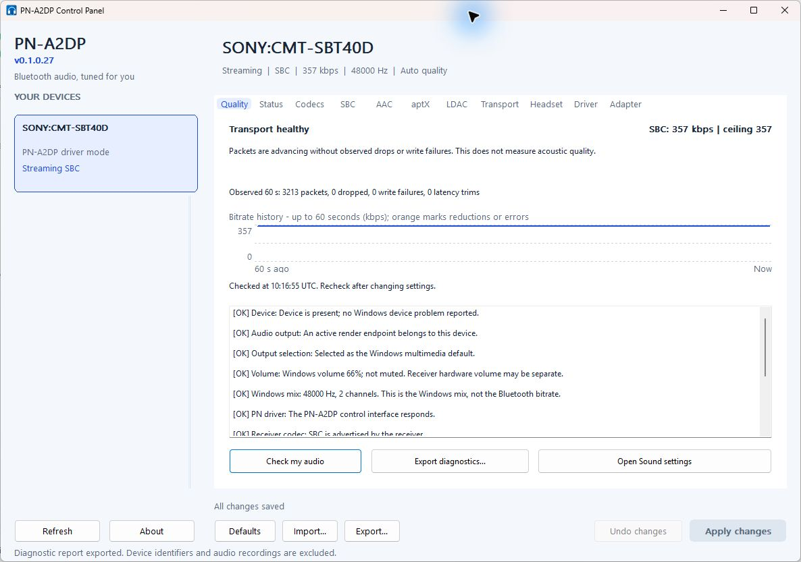

<div align="center">

# PN-A2DP

**Bluetooth audio, tuned for you.**

A Windows Bluetooth audio control panel with automatic codec selection,
adaptive quality, and diagnostics you can understand.

**Windows 10 / 11 · x64 · Control panel v0.1.0.38 · MIT project license**

[Get started](#get-started) · [Choose a mode](#choose-a-mode) · [Codec support](#codec-support) · [Documentation](#documentation)

</div>



*Actual control panel v0.1.0.34 (driver 0.1.0.21) on Windows 11, streaming LDAC at 990 kbps
to an EDIFIER MR5: 11,208 packets in 60 seconds with no drops, write failures or latency trims.
The dashboard reports observed transport health; it does not measure acoustic quality.*

## What you can do

- **Check my audio.** Inspect the selected device, its Windows output, volume,
  mute, format, and available codec information without changing your settings.
- **See live quality.** In PN driver mode, follow a rolling 60-second bitrate
  graph, packet progress, drops, write failures, and automatic quality recovery.
- **Let compatibility guide the codec.** Detect receiver support, match it with
  available encoders, and choose automatically or set your own priorities.
- **Start high and adapt.** Automatic quality respects the receiver's limits and
  your configured ceilings, reducing supported variable bitrates during sustained
  congestion and recovering after healthy traffic. New devices start every codec at
  its best level (LDAC HQ, AAC up to 320 kbps, SBC at the receiver's maximum).
- **Pick a listening profile.** Music buffers more so radio hiccups do not lower the
  quality, Balanced is the default, and Low latency suits video and games.
- **Any Windows rate, best codec.** A fixed-point, alias-free sample-rate converter
  (passband flat to 20 kHz, at least 122 dB stopband from the lower Nyquist frequency, no
  alias or image above -122 dB, THD+N below -139 dB) bridges 44.1, 48, 88.2 and 96 kHz
  Windows formats to the codec's 44.1 or 48 kHz, so the best codec the receiver offers is
  used and a Windows format change during playback does not renegotiate the stream (the
  Windows rate is still used natively whenever the receiver supports it).
- **Switch per device.** Use the Windows Bluetooth audio driver or the PN-A2DP
  driver for each paired receiver, with readiness checks and clear restart status.
- **Export useful diagnostics.** Save a local text report that omits device names,
  Bluetooth addresses, endpoint IDs, user paths, and raw logs. No audio is recorded
  and no report is uploaded automatically.

## Choose a mode

| Capability | Windows mode | PN driver mode |
|---|---|---|
| Bluetooth audio driver | Microsoft's built-in driver | PN-A2DP custom source driver |
| Output volume, mute, and Windows mix format | Available in the Audio tab | Integrated with Windows audio controls |
| Check my audio and diagnostic export | Device and output checks | Adds codec, encoder, service, and transport checks |
| Codec selection and tuning | Managed by Windows | SBC, AAC-LC, aptX family, and LDAC, subject to receiver support |
| Live Bluetooth bitrate and packet health | Not exposed by this backend | Available in the Quality tab |
| Automatic quality management | Managed by Windows | Receiver-aware policy for supported variable-rate codecs |
| Custom kernel driver required | No | Yes |
| Current installation path | Application-only installer or portable panel | Development package on a prepared test machine |

**Windows mode or Test Mode?** Windows mode keeps Microsoft's Bluetooth driver and
changes nothing about how Windows starts. PN driver mode loads PN-A2DP's own kernel
driver, which is signed only with a development certificate today, so Windows loads
it only in **Test Mode**, a boot setting for development-signed drivers. You choose
per speaker; switch speakers back to Windows mode *before* turning Test Mode off. See
[Windows mode and Test Mode explained](docs/19-windows-mode-and-test-mode.md).

**Start with Windows mode** for device controls and diagnostics without installing
a custom driver. It needs no Test Mode, driver certificate, or Microsoft developer
account. Installing this package preserves existing device driver assignments;
use **Driver → Use Windows mode** to move a device off the PN driver.

**PN driver mode is currently a development build.** The validated configuration
requires Test Mode on, Secure Boot off, and Memory Integrity off. The panel checks
these requirements before activation. Normal-mode distribution of the custom
driver requires a Microsoft-signed driver package; accepting a warning or adding
a self-signed certificate does not replace that requirement. See the
[build and installation guide](docs/04-build-sign-install.md).

## Get started

Download the [v0.1.0.38 experimental release](https://github.com/patnawa/PN-A2DP/releases/tag/v0.1.0.38)
([release notes](docs/releases/v0.1.0.38.md)) and choose the **Windows-mode installer**
for use without Test Mode. The separate **Test Mode installer** contains custom driver
0.1.0.25; stop playback and close the panel and browsers before installing it, and follow the
[setup and recovery guide](docs/17-test-mode-release-guide.md), including certificate
verification and the explicit developer option. SHA-256 checksums accompany the
downloads. A private repository's release requires repository access.

To build from source, use
**Visual Studio 2022 Build Tools** with the C++ x64 toolset and
**Windows SDK 10.0.26100**. The scripts discover the toolchain; the Visual Studio
IDE is not required.

```powershell
git clone --recurse-submodules https://github.com/patnawa/PN-A2DP.git
cd PN-A2DP
.\build\get-wdk.ps1
.\build\build.ps1 -Target windows -Config Release
```

Choose one of the generated Windows-mode packages:

| Package | Output |
|---|---|
| Installer | `out/Release/dist-windows/pna2dp-setup.exe` |
| Portable control panel | `out/Release/dist-windows/portable/pna2dp-panel.exe` |

Pair your speaker or headphones in Windows, open the panel, select the device,
and press **Check my audio** on the **Quality** tab. The **Audio** tab provides
volume and mute controls for devices using the Windows driver.

To explore the interface with simulated devices:

```powershell
.\out\Release\pna2dp-panel.exe --demo
```

Demo mode is visibly labelled and does not demonstrate physical receiver support.
For switching, installation details, and limitations, see [Windows mode](docs/13-windows-mode.md).

## Codec support

These controls apply to **PN driver mode**. A codec must be supported by both
the receiver and an available encoder. Windows mode uses Windows' own selection.

| Codec | Implementation and controls | Current validation |
|---|---|---|
| **SBC** | Built-in encoder and kernel fallback; receiver-limited bitpool and channel modes | Software tests, independent decoding, and physical Sony playback |
| **AAC-LC** | FDK AAC plugin; bitrate controls and adaptation | Software tests and independent decoding |
| **aptX / aptX HD** | libfreeaptx plugin; fixed codec bitrates | Software tests and independent decoding |
| **aptX Low Latency** | aptX encoder with LL negotiation and transport support | Software checks; receiver interoperability and latency remain unverified |
| **LDAC** | Sony libldac plugin; quality levels and adaptive bitrate | Encoder and parameter tests, and LDAC SQ / HQ (990 kbps at 48 kHz, 909 kbps at 44.1 kHz) playback on one physical receiver (EDIFIER MR5); independent decoding remains outstanding |

Automatic quality uses measured transport behavior as well as reported adapter
capabilities. Bluetooth version and EDR support alone do not establish usable
bandwidth. Fixed-rate aptX codecs cannot be reduced in-band. Since driver 0.1.0.23 the
driver converts a Windows rate the codec or receiver lacks (44.1 / 48 / 88.2 / 96 kHz to
44.1 / 48 kHz; streams at the Windows rate are not touched); other conversions (from 32 or
16 kHz, from 176.4 / 192 kHz, up to 88.2 / 96 kHz) are not done. AAC support is LC; HE-AAC
is not advertised.

Read more about [automatic adapter quality](docs/10-adapter-quality.md) and
[codec licensing](docs/05-codec-licensing.md).

Redistribution bundles include full codec notices and corresponding source
archives. This does not establish patent clearance or product certification.
Before publishing free binaries or selling the program, see the
[release-readiness audit and costs](docs/15-commercial-readiness.md).

## Audio quality

In PN driver mode, Windows now plays at the format you choose under **Sound > device >
Properties > Advanced > Default Format** (earlier PN drivers made Windows' shared-mode
engine use the driver's first listed format, normally 48 kHz, instead);
reopen your player after changing it. When the receiver supports that rate it is used
natively. Otherwise, or when you change the format while music plays, a fixed-point,
linear-phase, alias-free sample-rate converter in the driver bridges the rates (at least
122 dB alias and image rejection, flat to 20 kHz, about 2 ms of added latency) without
reconnecting the receiver. New devices start every codec at its best level (devices you
already use keep their saved settings), and a **listening profile** (Music, Balanced, Low
latency) on the **Transport** tab sets how much buffering rides out radio hiccups.
Details: [maximum audio quality](docs/20-max-audio-quality.md).

## Speaker delay (lip-sync)

Video players keep picture and sound together with the delay Windows reports for the
speaker, and that delay includes the speaker's own report, which can be wrong: the EDIFIER
MR5 reports 25 ms or 364 ms, while a microphone measured 267-340 ms (median about 315 ms).
Driver 0.1.0.25 ignores reports too low to be real and lets you set the delay yourself.
**Headset > Speaker delay (lip-sync) > Measure with microphone** plays eight short chirps,
finds the delay and enters it as a fixed value for the codec that is playing; **Apply
changes** saves it. The recording is analysed in memory and not saved. Because a speaker's
delay can change between stream starts, measure a few times and keep the middle value; the
result includes the microphone's own timing, so a value 20 to 30 ms lower is a safe choice. The
command line has `pna2dpctl measure-delay` and `pna2dpctl set sinkdelay=<ms>`. A speaker
that connects by itself now also gets its saved quality (LDAC HQ on the MR5, where driver
0.1.0.23 used SQ). Details: [speaker delay and lip-sync](docs/21-speaker-delay-and-lip-sync.md).

## Build and verify the full project

Build the driver, codec host, encoder plugins, tools, and installer:

```powershell
.\build\build.ps1 -Target package -Config Release
.\build\verify.ps1 -SkipBuild -Sanitize -Interop
```

The full installer is generated at `out/Release/dist/pna2dp-setup.exe`.
Building a package does not prepare Windows to load a development driver.
Follow the [signing and installation guide](docs/04-build-sign-install.md) before
attempting PN driver activation. The optional `-Interop` checks require Python
and FFmpeg on `PATH`.

The verification suite covers codec negotiation, AVDTP parsing and
reassembly, PCM conversion, RTP, configuration handling, diagnostics, service
operations, Windows-mode behavior, and installer signing checks. It includes the
core checks (58,271 for v0.1.0.38) also run under AddressSanitizer, 50,000 malformed
packet inputs, a codec plugin parameter matrix, independent FFmpeg decoding of SBC, AAC
and the aptX family, the speaker-delay measurement's analysis on synthetic recordings
(151 checks for v0.1.0.38, also under AddressSanitizer), and an end-to-end audio-quality
harness (for v0.1.0.38, 1,252 jobs and 24 FFmpeg baselines, 1,276 in all, with 0 defect
flags and known issue #31 within its bounds, including the sample-rate converter's alias,
distortion and bit-exactness checks) that flags clicks, gaps, clipping and accounting
errors. Build it with `.\build\build.ps1 -Target quality-tests`; `verify.ps1 -Interop`
runs it. The release run's results are in the [release notes](docs/releases/v0.1.0.38.md).

**Hardware tested:** Windows 11 build 26300 and Qualcomm FastConnect 7800 with two
receivers. Sony CMT-SBT40D (driver 0.1.0.19): SBC at 672 kbps, reconnects, volume, mute,
and audible playback. EDIFIER MR5: LDAC SQ and HQ (990 kbps) without drops, reconnects,
and an owner listening check without crackle (driver 0.1.0.20). On driver 0.1.0.23 the
MR5 played LDAC at 44.1 kHz natively as chosen in Windows' Default Format; switching
Windows to 48 kHz during playback was bridged by the converter without a reconnect and
with no crackle heard; the Music profile applied live; the session had no drops, write
failures or latency trims. On the intermediate driver 0.1.0.24, a stream the MR5 set up
itself after a power cycle ran LDAC HQ at 990 kbps (0.1.0.23: SQ, 660 kbps). A microphone
measured the MR5's real delay at 267-340 ms over 10 stream starts, against its reports of
25 and 364 ms. With a fixed 315 ms on driver 0.1.0.25, two checks heard the sound 27.4 ms
early and 16.8 ms late. The Sony was not
re-tested after 0.1.0.19. AAC and aptX receivers, receiver-initiated AAC / aptX / SBC
configurations, other speakers and microphones for the delay measurement, codecs other
than LDAC through the converter, the 48 to 44.1 kHz switch and pause/resume on a converted
stream, interference sessions, Driver Verifier/HLK, sleep/wake and broader power/PnP stress
coverage remain work in progress. See the
[test record and remaining coverage](docs/06-testing-plan.md), the
[maximum audio quality record](docs/20-max-audio-quality.md) and the
[speaker delay record](docs/21-speaker-delay-and-lip-sync.md).

<details>
<summary><strong>Repository layout</strong></summary>

```text
driver/pna2dp/       KMDF / PortCls WaveRT driver and INF
common/sbc/         Shared SBC encoder, decoder, and tests
codec-host/         User-mode codec host and encoder plugins
tools/pna2dp-panel/ Native Windows control panel
tools/pna2dpctl/    Command-line diagnostics and configuration
tools/pna2dp-setup/ Installer and uninstaller
tools/common/      Shared device, audio, driver, and diagnostic helpers
build/             Toolchain, build, packaging, and verification scripts
third_party/       Codec library submodules and their licenses
docs/              Architecture, installation, and validation notes
```

</details>

## Documentation

| Guide | Contents |
|---|---|
| [Audio diagnostics](docs/14-audio-diagnostics.md) | Check my audio, live quality, export contents, and privacy |
| [Windows mode and Test Mode explained](docs/19-windows-mode-and-test-mode.md) | Plain-language comparison, which to choose, turning Test Mode on and off safely, Thai summary |
| [Windows mode](docs/13-windows-mode.md) | Standard driver controls, switching, and boot-mode readiness |
| [Automatic quality](docs/10-adapter-quality.md) | Adapter detection, congestion response, and recovery |
| [Control panel and installer](docs/07-control-panel-and-installer.md) | Device controls, configuration, and installation behavior |
| [Build, sign, and install](docs/04-build-sign-install.md) | Development setup and driver deployment |
| [Production signing — ภาษาไทย](docs/11-production-signing-th.md) | Microsoft signing requirements and submission preparation |
| [Architecture](docs/03-architecture.md) | Driver, codec host, plugins, and control interfaces |
| [Testing](docs/06-testing-plan.md) | Reproducible checks, hardware results, and open coverage |
| [Driver review fixes](docs/18-driver-review-fixes.md) | Review, audio-quality and Connect / Disconnect changes in driver 0.1.0.21 / app 0.1.0.34, with evidence and limits |
| [Maximum audio quality](docs/20-max-audio-quality.md) | Best-quality defaults, latency profiles (Music / Balanced / Low latency), the alias-free sample-rate converter, the Default Format and delay-report fixes, and the hardware results of driver 0.1.0.23 / app 0.1.0.36 |
| [Speaker delay and lip-sync](docs/21-speaker-delay-and-lip-sync.md) | Implausible delay reports ignored, the fixed speaker delay and its microphone measurement, receiver-chosen configurations at the saved quality, and the hardware results of driver 0.1.0.25 / app 0.1.0.38 |
| [Test Mode release guide](docs/17-test-mode-release-guide.md) | Download verification, Test Mode setup, installation and rollback |

## Contributing

For a bug report, include the panel version, driver mode, receiver model, steps to
reproduce, and expected versus actual behavior. A report from **Quality → Export
diagnostics** can help; review it before sharing. For code changes, run the relevant
checks and state which codecs and hardware you actually tested.

## License

PN-A2DP's own code is licensed under [MIT](LICENSE). Third-party codec libraries
retain their respective licenses: Apache-2.0 for libldac, LGPL-2.1-or-later for
libfreeaptx, and the Fraunhofer FDK AAC license. See
[third-party notices](THIRD-PARTY-NOTICES.md) and the
[codec licensing guide](docs/05-codec-licensing.md) before redistribution.
